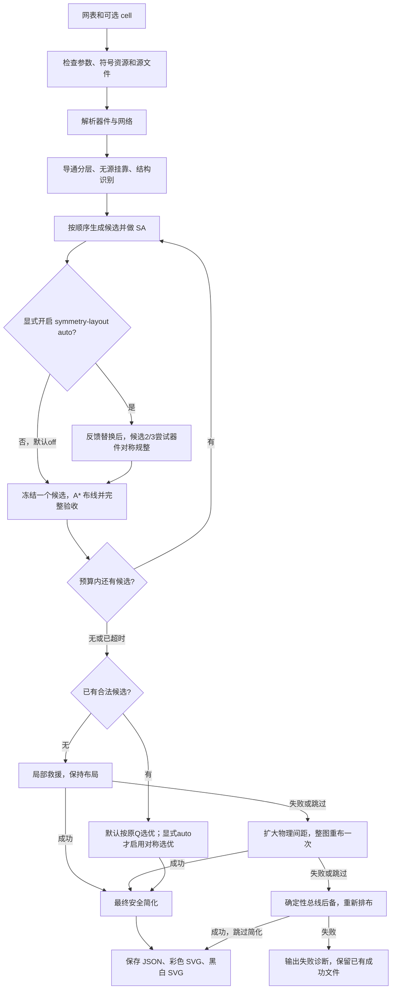

# 从网表到原理图：当前 flow 逐步详解

本文根据当前源码整理，说明默认的 `layered + structured` 流程，以及 `orthogonal-shortcuts-v5` 最终安全简化。历史运行实例保留其原有版本和来源，新增无源灵活布局与v5收紧的实测见[运行说明](flow-guide.md)。

你可以把整个任务理解成：**读懂有哪些器件及连接 → 判断上下层级和子结构 → 尝试几种摆法 → 为摆法真正布线并验收 → 必要时救援 → 收紧合法线路 → 保存并绘图。**

正常使用只需运行 `run_flow.py`。下面介绍的内部函数由入口自动调用，不需要你依次启动二十多个脚本。已有的[参数运行手册](flow-guide.md)用于查选项，本文用于理解这些选项背后实际发生了什么。

阅读导航：[总览与启动](#overview) → [解析与分层](#parsing) → [结构与SA](#placement) → [几何与A*](#routing) → [验收与选优](#validation) → [失败恢复](#recovery) → [简化与出图](#simplification)。查运行结果可跳到[JSON与诊断](#inspection)、[本轮实测](#examples)或[文件清单](#files)。

<a id="overview"></a>

## 1. 先看完整执行顺序



日常命令不加 `--symmetry-layout` 时默认为 `off`，图中的器件对称规整和S对称选优都会跳过，保留原Q选择。显式开启 `auto` 才执行这两步。图中的恢复分支只处理可恢复的布线失败。解析错误、未知器件、资源不匹配、源文件变化和损坏JSON会报错，不会用后备图掩盖输入问题。

默认预算如下：

| 阶段 | 做什么 | 默认预算 | 能否移动器件 |
| --- | --- | ---: | --- |
| 正常优化 | 生成候选、SA、最终A*、验收及候选比较 | 共300秒 | 生成/优化候选时可以；每次A*期间冻结 |
| 局部救援 | 延长安全接口，必要时小组重布 | 另加60秒 | 不可以 |
| 扩距重试 | 物理行列间距扩大1.5倍，再完整布线一次 | 另加60秒 | 只改变物理轴间距 |
| 总线后备 | 保留有源层级，重新安排专用通道 | 另加60秒 | 可以重新排布 |
| 最终安全简化 | 在已合法线路上缩短绕线、减少折角 | 另加5秒 | 不可以 |

各项上限相加约485秒，文件读取、资源检查及输出另有开销。阶段成功就跳过后续恢复；总线后备跳过安全简化。不是每张图都要花完这些时间。

**默认候选1、2、3共用300秒，不是每个候选各300秒。** 候选按顺序生成和评估；前面的A*耗尽预算，后面的候选可能还没有生成。当前不再默认计算候选0；下文旧图5由0耗尽预算后救援的记录属于调整前的历史实测。

## 2. 一条命令如何启动

### 2.1 日常命令

在PowerShell中执行：

```powershell
Set-Location D:\gongzuo

# 扁平电路
.\.venv\Scripts\python.exe .\run_flow.py .\examples\4.cir

# 图5：明确选择 dut 子电路
.\.venv\Scripts\python.exe .\run_flow.py .\examples\5.cir --cell dut
```

默认参数包括：

```text
mode             = layered
layout-style     = structured
iterations       = 20000
seed             = 20261029
quality-seconds  = 300
symmetry-layout  = off（跳过额外对称规整及S选优，按原Q选择）
fallback         = auto（普通网表输入）
local-rescue     = 跟随 fallback
simplify-routes  = safe
simplify-seconds = 5
```

以图5为例，默认生成：

```text
output/5-dut/
  5-dut-placement.json   器件坐标、层级、结构、最终线路、指标和验收记录
  5-dut-layered.svg      彩色图
  5-dut-clean.svg        黑白图
```

需要保留不同运行结果时，用 `--out-dir` 指定独立目录。同一个默认输出目录再次成功运行，会更新上述同名文件。

### 2.2 入口先检查什么

**代码：** [run_flow.py](../run_flow.py) 的 `main()`、`run()`、`_output_targets()`；[sa_common.py](../sa_common.py) 的 `configure_resources()`；[sa_geometry.py](../sa_geometry.py) 的 `validate_geometry()`。

入口依次检查：

1. 输入模式是否合法：网表、`--reroute-placement`、`--simplify-placement`必须三选一。
2. 迭代数、时间和间距倍率是否有效，输入文件是否存在。
3. 将路径变为绝对路径，确定输出文件名；防止输出覆盖输入网表或作为输入的JSON。
4. 计算所输入源文件的SHA-256，后续关键阶段及发布前复查，防止运行中途源文件被修改。
5. 定位符号定义，检查几何缓存是否与所选符号库一致。

源文件哈希针对入口记录的源文件，不能将它理解为所有 `.include` 依赖的完整版本锁定。复现时，本地模型声明和符号资源也需要保持一致。

带连字符的旧脚本，例如 `place-and-route.py`，通过 `sa_common.load_local()`按模块方式加载。资源路径按项目位置解析，因而可以从其他工作目录使用绝对路径启动。

当前环境是Python 3.12.10，唯一第三方Python依赖记录在 [requirements.txt](../requirements.txt)：`networkx==3.7`。本机 `.venv`依赖 `.python/distribution/tools`中的解释器；移动目录后应重建虚拟环境。出图不需要启动网页项目或电路仿真器。

<a id="parsing"></a>

## 3. 第一步：把网表变成统一的器件与连接数据

**代码：** [netlist_core.py](../netlist_core.py) 的 `parse_netlist()`、`classify_tokens()`、`to_document()`；[parse-netlist.py](../parse-netlist.py) 的 `parse()`。

### 3.1 先处理文本和作用范围

解析器会：

1. 按UTF-8读取，兼容BOM，跳过空行和 `*`注释，处理 `;`、`$`行内注释。
2. 将 `+`续行接回上一条语句。
3. 展开本地 `.include/.inc`，相对路径以包含它的文件为基准；拒绝循环包含及过深嵌套。
4. 区分顶层和 `.subckt`；有 `--cell dut`就只选择该子电路。
5. 收集 `.model`类型声明，再读取所选范围内的器件。

这里不会自动递归展开任意层次化X实例，也不运行 `.op/.tran`等仿真指令。数值和表达式只用于结构读取，不做参数求值或电气仿真。

### 3.2 识别哪些器件

| 网表前缀 | 当前识别 | 重要边界 |
| --- | --- | --- |
| `M` | NMOS、PMOS | 读取D/G/S/B和型号，极性由 `.model`或明确型号规则判断 |
| `X` | 明确nfet/pfet型号的MOS映射 | 支持图5的SKY130写法；不是任意子电路展开 |
| `Q` | NPN、PNP | 支持可选衬底，不能塞进MOS结构模板 |
| `R/C/L/D` | 电阻、电容、电感、二极管 | 两端连接 |
| `V/I` | 独立电压源、电流源 | 只绘制网表实际已有的源 |
| `E` | 线性VCVS的运放代理 | 输出负端必须接地别名；非线性形式不支持 |

网络名统一为小写；实例ID保留原写法，但重复ID判断不区分大小写。`VDD`、`VSS`等供电别名会被识别为电源/地标记用途，这不等于给网表增加电源器件。

例如：

```spice
M1 out vin tail VSS NMOS W=1u L=150n
```

它先成为带类型、端子和源文件行号的规范化器件。随后投影为绘图数据，示意如下：

```python
components = [
    {"id": "M1", "symbol": "nmos",
     "nodes": {"D": "out", "G": "vin", "S": "tail"}}
]
nets = {
    "out": [("M1", "D")],
    "vin": [("M1", "G")],
    "tail": [("M1", "S")]
}
```

`components`回答“画哪些器件”；`nets`回答“每个网应连接哪些原始引脚”。后续分层和绘图共用这一套解析事实，避免一边识别到器件、另一边漏掉。

**可见引脚范围：** MOS体端和BJT衬底保留在规范化结构中，但不单独画线；E代理只画OUT、IN+、IN−。最终连接验收针对当前符号的可见引脚，不代表所有隐藏端子的仿真连接验证。`.subckt`的外部端口名称本身也不会自动变成电压源或单独器件。

### 3.3 如何单独观察

```powershell
.\.venv\Scripts\python.exe -X utf8 .\parse-netlist.py .\examples\5.cir --cell dut
```

终端会打印器件和网络JSON，以及数量。这个命令只解析，不布局、不布线。错误会指出源文件及行号；不能判断型号、未知器件、未配对 `.ends`等问题不会被静默忽略。

## 4. 第二步：决定谁在上、谁在下

**代码：** [device_leveling.py](../device_leveling.py) 的 `compute_levels()`、`build_active_edges()`、`tarjan_scc()`、`pick_sources()`、`longest_levels()`。

这一步是**根据连接拓扑估计导通层级**，不是先仿真出真实电流或电压再分层。

### 4.1 有源管构成“向下流的骨架”

只将MOS、BJT的主要导通端加入有向边：

| 类型 | 建边方向 |
| --- | --- |
| PMOS | S → D |
| NMOS | D → S |
| PNP | E → C |
| NPN | C → E |

栅极/基极是控制端，不用来定义这条上下骨架。R/C/L/D、独立源和E代理也不作为这种有源导通边；源的端子可参与寻找起点。

例如抽象支路 `VDD → PMOS → 中间网 → NMOS → VSS`，会形成从上到下的连续层级。

### 4.2 有环和断开的分支怎样处理

1. 用Tarjan算法找强连通分量：彼此沿有向边可相互到达的网络，先临时合成一组，避免环让层级一直增加。
2. 缩成无环图后，优先采用供电别名和电流源相关节点作为起点。
3. 对这些起点没有覆盖的有源分支，补充其无入边根节点；这解决电阻负载等分支没有从VDD有源边直接到达的问题。
4. 在无环图上取从起点出发的**最长路径层数**，得到网络层级。
5. 对MOS/BJT，取两个导通端已到达层数的较小值再加1，得到器件层级。

保存字段 `levels`主要描述有源器件的导通层级。一个控制网的网络层为 `-1`，可能仅表示它没有参与导通骨架，不能直接理解为电气断线。

### 4.3 无源和源件是否也做相同的电流分层

不是。它们先做**挂靠**：根据连接到哪条支路、哪个控制网和哪个供电端，决定放在相应层旁边或中间空行。

**代码：** [place-layered.py](../place-layered.py) 的 `attach_info()`、`_allocate_rows()`；结构化初排还会进一步调整。

| 挂靠情况 | 当前处理思路 |
| --- | --- |
| 接地R/C等 | 靠近非地端对应的有源层，而非所有器件统一沉到底部 |
| 接电源的无源件 | 贴近对应支路，可分配上方挂靠行 |
| 导通网与控制网之间的器件 | 生成偏置/反馈挂靠关系 |
| 两端跨不同导通层 | 在跨度内部选择挂靠边界，必要时插入间隙行 |
| 从电源送出的源件 | 使用上方源件行 |
| 下拉源、信号电压源等 | 按源件类别和锚定网分配行 |
| E运放代理 | 按输出锚定；无MOS/BJT骨架时使用专门的反馈初排 |
| 纯无源电路 | 不制造假的MOS电流层，使用紧凑的局部排布 |

`levels`与最终 `placement.row`不是同一个概念：前者是导通层号，后者是含挂靠空行的逻辑画图行。无源器件也有row，并不说明它采用了MOS的分层算法。

挂靠现在决定的是**初排位置**。默认 `--passive-layout flexible` 时，新结构SA种子1～3里的R/C/L/D随后可以在SA中换行，也能进入MOS/BJT同行的合法空位。MOS/BJT及E/V/I仍保留初排行约束；MOS/BJT原有的组移动、组内调整和左右镜像继续有效。选择 `fixed` 可恢复所有器件保持原分配行的行为。候选0、legacy、baseline沿用原规则；若最后一个候选槽位改用已有最佳布局的布线反馈版本，则继承该布局的实际策略，不额外运行无源SA。

可以单独打印分层解释：

```powershell
.\.venv\Scripts\python.exe -X utf8 .\device_leveling.py .\examples\5.cir --cell dut
```

这里的挂靠文字是诊断说明；真正用于布局的row以 `_allocate_rows()`和最终JSON为准。

<a id="placement"></a>

## 5. 第三步：认出子结构，保留各器件的角色

**代码：** [circuit_structures.py](../circuit_structures.py) 的 `analyze_structures()`；旧参考候选仍使用 [vf2_match.py](../vf2_match.py)。

默认新布局主要使用连接拓扑规则，而非仅看到“两只管子连一起”就把它们成对。

每类结构的实际连接示意、辅助关系与旧模板区别见[子结构图鉴说明](structure-gallery.md)；按说明生成后，可在 `output/structure-gallery/index.html`逐图查看。

| 结构 | 识别证据和保留的角色 |
| --- | --- |
| 差分对 | 同类型、共同源节点、两个不同输入和支路，并有尾部器件/电流源证据；保留左右支路及尾部证据 |
| 电流镜 | 同类型、共同源/栅，并有D=G的参考管和输出管；区分reference和outputs |
| 互补支路/输出级 | 上方PMOS与下方NMOS连接共同输出；保留upper/lower |
| 交叉耦合、锁存核心 | 交叉控制连接；可与互补支路组合为父结构 |
| 折叠核心 | 输入、折叠及偏置支路的连接关系；保留各支路角色 |
| 串联链、并联无源、运放反馈 | 按实际串联次序、并联端点及IN+/IN−反馈关系识别 |

共电源、共地或多只管子共源，不会单独成为高置信差分对。一般共偏置、共栅等可作为普通 `relation`存在，但不会像高置信结构一样强制占有器件。

每条结构记录可以有 `roles`、`confidence`、`parent/children`、`owner`和 `layout`建议。这样锁存块可以包含子结构，不必让多个互相重叠的框各自拉扯器件。

VF2旧代码使用“器件—网络”二部图和带引脚标签的子图匹配，主要保留给旧参考布局。**新结构化布局并没有把旧VF2的宽松配对当作全部布局依据。** BJT参与分层和绘图，当前MOS结构模板不匹配BJT。

规则不按 `5.cir`、`XM14`等名称设置坐标。对完全对称的拓扑，稳定排序仍可能用名称打破平局；因此“结构泛用”不等于改名后每个像素必然一致。

## 6. 第四步：生成候选摆法，再用SA调整

**代码：** [structured_placement.py](../structured_placement.py) 的 `create_candidates()`、`_initial_placement()`、`StructuredPlacement.propose()`、`_anneal()`；[passive_placement.py](../passive_placement.py)增加无源跨行动作和软评分；[aesthetic_flow.py](../aesthetic_flow.py) 的 `select_layout()`组织候选比较。

### 6.1 默认三个候选及显式旧参考分别是什么

| 编号 | 产生方式 | SA提案预算 | 启用方式 |
| --- | --- | --- | --- |
| 0 | 旧分层布局作为参考 | 最多 `iterations`次，默认20000 | 仅显式 `--candidate-id 0` |
| 1 | 第一种结构初排 | 最多 `iterations // 3`次，默认6666 | 默认 |
| 2 | 第二种结构初排 | 最多6666次 | 默认 |
| 3 | 第三种结构初排，或实际布线反馈产生的候选 | 初排种子最多6666次；反馈候选另行见第9节 | 默认 |

因此 `--iterations 20000` 在默认流程中是三个新结构种子各最多6666次，合计约20000次，不是每个候选各20000次；无效提案和时间截止会减少实际有效动作。显式候选0单独使用旧SA的20000次预算，不会再生成并比较其他候选。

新结构种子使用 `seed + (variant + 1) × 104729`。每个新种子的SA还受最多约12秒的局部截止时间限制，并受正常阶段总截止时间限制。候选0保留旧SA行为。

候选是惰性生成的：**生成1并布线评估1 → 生成2并布线评估2 → 生成并评估3或其反馈版本。** 候选0的初始化、旧SA、VF2和最终A*均不在默认路径中，器件/网络/索引直接从统一解析器取得。显式回放1～3也不会先计算0；3的回放先评估1、2，以保留布线反馈来源。

### 6.2 初排怎样让结构和支路在一起

1. 依据层级与挂靠得到 `row_of`。
2. 从高置信结构建立器件块，并为上下串接、互补上/下管建立对齐关系。
3. 按角色安排左右次序：差分两支路分开、上下输出管尽量同轴、电流镜保留参考/输出关系。
4. 做8轮上下交替扫描，按其他层连接器件的加权平均横坐标排列本层块。通俗地说，下面连接大多在左边的块，就倾向放到左边，以减少支路互相穿插。
5. 调整栅极/基极朝向，使控制端朝向它要连接的其他端子。
6. 对不含MOS/BJT的运放代理电路，按实际IN+/IN−引脚组织反馈串联链及并联/接地支路；纯无源电路采用紧凑排布。

### 6.3 逻辑格子与实际坐标

布局保存 `(row, col, orient)`，同时可以保存物理轴：

```text
x = layout_grid.column_x[col]
y = layout_grid.row_y[row]

某个引脚的世界坐标
  = 器件中心世界坐标 + 对应朝向下的引脚局部坐标
```

**代码：** [place-and-route.py](../place-and-route.py) 的 `Placement.pos_of()`、`pin_world()`、`pin_dir()`。

候选0原网格间距为150；三个结构种子的初始横/纵间距分别为110/112、124/126、100/106。最终还会按实际朝向的符号包围盒、两边halo和通道数量检查下限，必要时扩开物理轴，不是无条件把大符号挤进固定100间距。

下限检查由 `_enforce_geometry_floor()`执行，默认预留两个12的halo和两条10间距通道，再加相邻符号的实际外伸尺寸。更新的是物理坐标，不会改变MOS/BJT的上下逻辑层。

朝向来自 `symbol-geometry.json`，符号绘制与引脚坐标使用一致的旋转、镜像规则。MOS/BJT只允许正常或左右镜像；无源件等使用各自允许的朝向。

### 6.4 SA每一步实际做什么

SA就是“试着挪一下，再决定留不留下”，不是训练一个神经网络。

新结构化SA原有动作包括整块平移、整块镜像、行分布兼容的块交换、块内器件换位/移位及允许的朝向变化。MOS/BJT和E/V/I保留其初排逻辑行；动作不能产生重复占位，也不能把无关器件插进同一有源块在某一行的内部。

默认的无源灵活布局在保留原初排的基础上，为候选1～3各追加一行、两列空位。SA期间物理坐标轴不变，不会边搜索边插行。每次提案有50%机会沿用原动作，另50%机会尝试无源二维动作：90%在周围八个格子中选一步，10%尝试同一非电源网邻居附近的空位；无可用邻居时退回局部移动。目标为空就移动，目标为另一个可移动无源件就交换，目标为MOS/BJT/E/V/I则拒绝。允许进入有源块外的同行空位和层间空间，不会把多行父结构的整个矩形内部全部封锁。

这些关系不是刚体：串联R/C可以分别调整，反馈路径共享器件也不会被复制到多个块。每次接受、撤销、温度采样或恢复最佳状态，都从 `cell_of` 和 `orient` 重建当前 `row_of` 与占位表。这样，无源跨行后旧动作和评分看到的仍是它的当前行。

```text
保存当前摆法
提出一个合法动作
快速估算新摆法的能量 E_new
若更好：接受
若更差：按 exp(-(E_new - E_old) / T) 的概率接受
若拒绝：恢复刚才的摆法
持续保存遇到过的最好摆法，结束时恢复它
```

温度高时，允许暂时走向较差摆法，争取跳出局部位置；温度低后更保守。新SA先采样最多64个动作的能量变化，用二分搜索标定初温，使采样的正能量增量平均接受概率目标为70%。这不是保证整个运行实际接受率为70%。

温度逐渐降到初温的约1.5%；停滞时最多重热两次。`annealing`记录实际提案、接受率、上坡接受率、温度、重热次数和停止原因。

### 6.5 SA期间到底怎么“连线”

**SA迭代中不调用最终A*。但不同候选的估价方式不完全相同：**

| 摆件分支 | 每次估价做什么 | 代码 |
| --- | --- | --- |
| 候选0旧参考 | 快速pattern粗布线：曼哈顿MST、Steiner局部细化、直线/L形等规则，估算线长、交叉、折角等 | `place-layered.py:sa_layered()` → `place-and-route.py:route()` |
| 候选1～3新结构种子 | 不生成完整合法线路；用引脚包围盒跨度、层间连接反序、估计折角、结构和拥塞等快速几何量评分 | `structured_placement.py:_estimate()` |

MST可以理解为先用一棵总连接距离较小的树把端子串起来，Steiner细化再尝试增加共享转接点。这是粗估，不保证满足最终几何规则。

新结构化估价的主要公式为：

```text
E = (
      估计线长 + 控制引脚背向连接的代价
    + 150 × 估计交叉 + 15 × 估计折角
    + 100 × 支路错位 + 65 × 块内分散
    + 100 × 配对过度分离 + 125 × 角色次序混乱
    +   8 × 估计拥塞
) / 100

# 仅在 flexible 无源候选中，再加：
+ 0.5 × 串联邻接 + 1.0 × 并联规整 + 0.25 × 反馈局部
```

其中估计线长是各信号网 `maxX-minX + maxY-minY`之和，也称HPWL；估计交叉看层间支路左右顺序是否颠倒；拥塞估计来自不同网引脚包围盒的重叠面积。它们都不是最终画出来的线段统计。

无源三项都按去重后的关系取平均，距离以100为单位归一化。串联项看共享端子的实际距离；并联项比较横排和竖排的同网端点错位及朝向一致性，取较规整的一种；反馈项看路径首末件和接地支路到对应OUT、IN+或IN−端口的距离。它们只引导SA，不改变最终A*权重、几何规则或真实候选质量评分。

JSON用 `requested_passive_layout` 保存请求策略，`passive_layout_policy` 保存实际选中策略；`passive_layout` 保存版本、可移动器件、固定行、规整评分和动作计数。`move_counts` 是包含温度采样的提案计数，其中合法提案仍可能被退火拒绝，不等于最终接受的移动次数。无无源件或候选0胜出时，即使请求 `flexible`，实际策略仍为 `fixed`。

旧参考候选保留旧目标：粗线长、500×交叉、30×折角、1000×穿体、15×重叠长度，以及结构面积/配对距离乘粗线长的耦合项。新结构化SA不再使用这种结构面积乘整图线长的形式。

两种SA能量的定义不同，不能直接拿候选0的 `energy`和候选1的 `energy`判谁画得更好；最后必须用真实布线比较。

<a id="routing"></a>

## 7. 第五步：冻结布局，建立最终布线场景

**代码：** [sa_routing.py](../sa_routing.py) 的 `final_route()`；[routing_rules.py](../routing_rules.py) 的 `RoutingOptions`、`build_scene()`、`Scene`。

所谓“冻结”，是本次路由不再移动器件中心、改变逻辑层或翻转朝向。路由器使用这张布局的真实引脚坐标建立场景。

### 7.1 场景包含什么

| 数据 | 含义 |
| --- | --- |
| `body_rects` | 各器件包围盒加halo后的保护区 |
| `marker_rects` | 电源/地标记的保护区 |
| `all_pins` | 所有可见引脚的真实坐标 |
| `pins`中的 `point` | 信号引脚的真实位置 |
| `pins`中的 `escape` | 沿真实引脚方向、退出自身halo后的临时出口 |
| `fixed_segments` | 真实引脚到出口的固定短段，以及电源接线 |

可以想象为：先在每个门口留一段不能改的出入口，再在门外找路。`escape`不是另一个电气引脚，也不能为了寻路方便移动真实 `point`。

普通电源网不经过信号A*来拉全图电源干线，而是在各实际供电端画stub及电源/地标记。它们提前进入障碍模型，不能在最终画图时才加上，碰到信号线后才发现。

### 7.2 全程共用的几何硬规则

| 项目 | 默认值/要求 |
| --- | --- |
| 线宽 | 2.5 |
| 异网笔画边缘净距 | 至少6 |
| 平行线中心距 | `ceil((2.5 + 6) / 2) × 2 = 10` |
| 轨道步长参数 | 2；用于边界轨道等，不代表每个坐标都强制量化为2 |
| 器件halo | 12 |
| 原引脚及分支保护距离 | 12 |
| 合法异网交叉 | 必须直线穿过，远离两网引脚、拐角、分支和线端至少12 |
| 固定引脚出线段 | 不允许异网在其上交叉 |

距离检查采用轴对齐的方形净区，即L∞距离，而非画一个欧氏圆。引脚退出自己的halo，只豁免其指定固定通道；同网并不自动获得穿过任意器件的权利。

异网共轨、贴线、T形接触、线端碰线、穿体和不合规交叉都是禁止项。清楚的十字交叉允许存在，交点不画圆点，不画跨线桥；同网真实分支画圆点。

## 8. 第六步：用正交图A*构造完整信号网

**代码：** [orthogonal_router.py](../orthogonal_router.py) 的 `route_scene()`、`_route_net()`、`_find_path()`、`_axes()`。

### 8.1 压缩坐标图怎样建

它不会对整幅画面逐像素搜索，而是收集“有意义的横纵坐标”：引脚及出口、器件/标记保护区外侧、已有走线旁的间距边界、净区边界及外围通道。

横坐标集合与纵坐标集合交叉形成候选节点，相邻横/纵节点之间尝试连接。只有通过障碍和占用检查的水平/竖直边才可使用。这是压缩正交图，接近Hanan图的构造思想。

图越拥挤，已有路线产生的边界坐标越多；横坐标数和纵坐标数相乘会使搜索规模迅速增加。

### 8.2 先布哪个网，每个网先连谁

逐网顺序固定为：**端子数多的优先 → 引脚包围盒跨度大的优先 → 网名稳定排序。**

一个网内部：

1. 按坐标、器件索引及引脚名稳定排序，选择固定根端子。
2. 根的固定短段成为初始连接树。
3. 从剩余端子中，优先选择出口距离当前树最近的端子。
4. 用A*从该出口接到树上的合法位置，不必只接某个原端子。
5. 加入真实引脚的固定短段，合并同网重合线段，再连接下一个端子。

这叫逐步构树。同网可以共享干线或形成合法T接；其他网已经布好的路线及所有固定出线都会成为约束。

### 8.3 A*怎样选方向

A*的状态含“当前坐标”和“进入该位置的水平/竖直方向”。保存方向是为了判断下一步是否产生真实折角。

```text
已走代价 g = 路径长度
           + 15 × 折角
           + 150 × 合法交叉
           + 历史拥塞惩罚

预估剩余 h = 当前点到目标树的最小曼哈顿距离
搜索优先级 f = g + h
```

历史拥塞项来自之前拆掉路线附近的区域，按经过长度累计，代码乘数为50。禁止边不靠“大罚分”来勉强接受，而是直接不能走。

`Scene.edge_check()`检查线段，`Scene.vertex_check()`检查需要停留、转弯或接入的位置。普通A*保留原有起点检查；沿出线方向继承和双端安全接口属于失败后救援明确启用的能力，未把曾回退的全局起点修改重新打开。

在当前默认 `structured`流程里，**包括候选0的最终A***也使用150/15。显式使用 `--layout-style legacy`或 `--mode baseline`时，最终A*保留旧500/30代价。不要把候选0旧SA的500/30与它在默认流程中的最终A*混淆。

### 8.4 堵住后怎样拆网重布

无法连接时，搜索返回 `blocking_nets`。路由器从已完成、可重布的网络中，选贡献较高的最多两个，移除其路线，先重布失败网，再重布被拆网。器件、固定引脚出线、电源标记不能拆。

旧路线附近会记入历史拥塞区域，降低反复抢占同一通道的倾向。没有找到合格结果时，外围范围可以按150、300、600扩大，每一档重新构建线路占用；拆网轮次计数与历史在此次路由调用中保留。

搜索还受以下上限限制：

| 上限 | 范围 |
| --- | --- |
| 压缩坐标图100000节点 | 每次分支搜索构图 |
| A*展开200000状态 | 每次分支搜索 |
| 拆网最多4轮 | 一次整图路由调用累计，不是每个网或每档外围各4轮 |
| 正常阶段截止时间 | 整个候选优化共享300秒 |

预算超限可能提前退出，不一定会尝试完所有外围档位。“预算内没找到”不等于数学上不存在路线。

### 8.5 为何A*仍可能绕很远

它在当前已经占用的场景中，为当前分支找低代价路线，不会同时求所有网络、所有根节点、所有布线次序的全局最优。早期连接树、别的网的占道、出入口净区、交叉代价及历史拥塞，都可能让外围绕行成为本次搜索选择。

布局固定只代表可走空间固定，并不代表合法路线唯一；树接入点及布网次序也影响结果。固定输入、参数和不被不同时间位置截断的执行有稳定顺序，但墙钟预算下机器负载会影响跑到哪个候选/事务，不能只凭seed保证任何一次超时运行都逐线一致。

<a id="validation"></a>

## 9. 第七步：完整验收，并决定哪个正常候选胜出

### 9.1 为什么A*找到路还要验收

**代码：** [sa_routing.py](../sa_routing.py) 的 `_verify()`、`routing_errors()`、`measure_routes()`；[routing_rules.py](../routing_rules.py) 的 `canonical_topology()`、`analyze_routes()`。

搜索时检查的是一个个局部动作，验收检查的是最终拼起来的整张图。局部可走不等于所有端子都已接上，也不等于拼接后的分支和折角均合法。

在接受单网时，路由器会检查新增网络的几何；整图完成后，再做原始引脚连接和整图几何验收。

先将同网共线重叠区间合并，区分真正的引脚、折角、分支和线端，忽略无意义的共线切段。否则同一个十字交叉被人为切成几段后，可能被错判成线端相碰，或交叉数统计不一致。

完整验收包括：

1. 每个需要连接的原始可见信号引脚是否落在正确网络的线上。
2. 同网线段图是否连成一个整体，有没有遗漏信号网或多出来的网络。
3. 线段坐标是否合法、是否全为水平或竖直。
4. 异网是否重叠、贴线、误接，十字交叉是否满足直穿和净区要求。
5. 是否穿过器件或电源标记保护区，是否侵入异网固定出线。
6. 使用显式电源引线时，端口、标记类型、真实接点、有序引线及入口通道是否正确。

同一套验收也用于救援、扩距、总线后备、最终简化和含保存路线的独立重绘。旧JSON中的 `valid=true`不替代当前检查。

`validation.valid=true`的含义是当前支持的可见引脚连接及几何硬约束通过，**不表示零交叉，也不表示已经做了电路功能仿真。**

### 9.2 最终候选用什么评分

**代码：** [layout_quality.py](../layout_quality.py) 的 `evaluate_quality()`。

它从真实线路重新计算，而不是直接相信SA的估计：

```text
Q = 实际信号线长 / 100
  + 1.5 × 实际交叉数
  + 0.15 × 实际折角数
  + 0.5 × 超出HPWL的线长 / 100
  + 结构对齐代价
  + 结构分散代价
```

分数越小越好。结构对齐基于实际坐标差；结构分散包括无关器件插入、结构跨度过大等因素，并考虑父子块关系。

每个网还会记录：

| 量 | 怎样理解 |
| --- | --- |
| `wirelength` | 去重后的实际信号线长 |
| `hpwl` | 引脚包围盒的横向跨度加纵向跨度 |
| `detour_factor` | 实际线长 / HPWL；端子条件不满足时为null |
| `excess_detour` | `max(0, 实际线长 - HPWL)` |
| `outside_length` | 位于该网引脚包围盒之外的线长；用于诊断，不是单独再加一次评分 |

例如两个引脚相距很远，必须拉一条长直线，它本身会贡献线长，但不因“长”就自动获得绕远附加项。障碍、固定出线和多端树也可能使线长高于HPWL，差额不代表全部都能删掉。

默认 `--symmetry-layout off`，候选比较先看Q，再用交叉数、线长及候选编号稳定打破平局；不执行额外器件对称规整和S对称选优。只有显式 `--symmetry-layout auto` 时，候选1保持原摆法，2/3在SA和候选3反馈替换后、A*前尝试器件对称规整。开启后仍保留原Q的含义：先按原Q确定本轮参考，再在参考实际线长125%范围内按高置信对称关系满足情况、网格精度的位置残差、原Q选优。没有可靠对称关系时沿用原Q。

可选的对称阶段只改器件位置与合法朝向，不要求导线对称；暂不新增上下串管同轴目标。开启后每候选最多1秒，计入原正常预算，不增加A*调用次数。每份合法结果都会深拷贝其布局和路线；后续候选失败或超时不会抹掉它。显式指定候选编号时仍返回指定结果。独立指标、边界及显式auto/off实验见[器件对称布局说明](symmetry-layout.md)。

### 9.3 真实布线怎样反馈给布局

默认最多三个候选。准备评估稳定编号3的最后一个槽位时，如果前面候选1、2的最佳结果有某网：

```text
detour_factor >= 2.5
且 excess_detour >= 500
```

则优先尝试反馈候选。这里的最佳按原Q决定；即使显式开启最终器件对称选优，也不会改变反馈来源。`structured_placement.feedback_candidate()`进一步寻找有跨行端子、至少三个端子的可用信号网，选择拥挤的行间切口，在切口下方增加32的物理纵向空间。

逻辑row/col和朝向不变，但部分器件的实际y坐标改变；随后重新整图A*、验收和评分。没有合适反馈位置就保留第三个结构种子。这个机制只占最后一个候选槽位，不是每发现一条长线就无限重新布局。

**此处的2.5/500阈值是“布局反馈”的触发条件，不是最终安全简化的统一触发阈值。** 两个环节不能混为一谈。

### 9.4 正常阶段结束时的分支

```text
至少有一个完整合法结果：选最好的一份，跳过全部失败恢复。
一个也没有：把最后实际布线失败的候选及其安全现场交给恢复链。
```

不会在候选1刚失败时立刻救援它，再让救援结果抢走后面正常候选的机会。最终简化也在选定胜者之后才执行；候选比较时不先做完整后处理再重新排名。正常阶段全部失败时，恢复链使用最后实际尝试的失败候选，通常为3；若预算在1或2耗尽，就使用对应实际现场。

<a id="recovery"></a>

## 10. 第八步：正常阶段全部失败后，按顺序恢复

**总调度代码：** `run_flow.run()`、`_try_local_rescue()`、`_bus_result()`。

### 10.1 局部救援：先修接口，尽量保留已有路线

**代码：** [local_rescue.py](../local_rescue.py) 的 `rescue_routing()`、`_anchors()`、`_goal_choices()`、`_route_local_net()`、`_transaction()`。

普通路由失败时，保存的私有检查点包括：原始场景、已完成网络、失败网、待布队列、失败引脚、外围范围及路由参数。中途没有完成的网络不会冒充已完成网络。这些运行对象通过异常私有上下文传递，不写入JSON。

救援先保持布局及所有已完成网络，尝试接上失败网和剩余网络。主要解决两类接口问题：

- **源端不够安全：** 真实引脚的固定出口附近没有合适搜索起点，沿原引脚出线方向加一段普通导线，到更安全的位置再搜索。
- **目标树没有安全接点：** 只对树上由人工出口形成的叶端作合法延长，提供新的接入位置。真实引脚、已有折角和实际分支不能获得这项额外待遇。

固定引脚和 `Pin.escape`都不改变。延长出来的部分按普通信号导线检查，不会扩充器件豁免区，也不降低10/12的间距规则。

默认限制：

| 限制 | 当前行为 |
| --- | --- |
| 延长半径 | `8 × max(cross_clearance, center_spacing, grid_step)`，默认96 |
| 每端接口 | 最多保留最近四个合法位置，源端也可能包含原出口 |
| 每分支接口组合 | 按新增延长长度稳定排序，最多八组 |
| 目标无安全接点 | 返回 `no_safe_goal`，不启动无目标的A* |
| 搜索方向 | 救援显式传入初始方向，计入首次真实折角，禁止首次反向折返 |

搜索仍使用A*，但从修复后的接口开始。额外接口坐标加入压缩图；未用到的目标延长尾段会裁掉，实际留下的全部延长都计入线长和验收。

如果冻结已有网仍连不通，再按直接接口阻挡和搜索blocker排序，每次移除最多两个已完成阻挡网作小组重布。小组外网络保持不动；可尝试失败网优先、可用接口少的网优先等确定性顺序，重复顺序跳过。

初始续布之外，最多进行 `max_rounds`次小组事务，默认4次；失败事务从检查点回滚，不把临时占用留给下一次。查询缓存随占用重建，不继承正常阶段历史拥塞，不继续扩大外围范围。

构造、A*、评分和整图验收共用新的60秒截止时间。找到第一份完整合法整图就返回，不继续用剩余时间搜更漂亮的救援方案。成功标记 `routing_stage: local_rescue`。

没有可用检查点时会跳过；例如最终整图复验失败，系统不会把未证实安全的部分线路直接当作冻结线路继续救援。

### 10.2 扩距重试：只把物理行列撑开

**代码：** [spacing_retry.py](../spacing_retry.py) 的 `retry_spacing()`、`_axis()`、`_expanded_axis()`。

局部救援失败后，复制**原正常阶段**最后实际失败候选，不使用救援中尝试过的临时路线或摆法。

```text
新轴第一个坐标 = 原轴第一个坐标
新相邻间距 = ceil(原相邻间距 × 1.5 / grid_step) × grid_step
```

例如100的间距变150；101的间距乘1.5得151.5，按2向上取整后为152。没有物理轴的旧JSON，先按中心 `75 + 150 × 索引`恢复。

保留row/col/orient及符号尺寸、引脚局部坐标、halo。电源标记随器件按规则重新建立。丢弃旧路线，从空占用、空拥塞历史和空查询缓存调用一次完整 `final_route()`，有新的独立60秒预算。

“只试一次”是一次整图路由调用；它内部仍可逐网A*、拆网和按外围档位尝试。成功标记 `spacing_retry`；失败不再加另一个倍率，继续总线后备。

### 10.3 总线后备：用空间换取更容易构造的连接

**代码：** [fallback_bus.py](../fallback_bus.py) 的 `create_fallback()`、`_ports()`、`_lanes()`、`_signal_routes()`、`_power_connections()`。

这一步不运行SA，也不运行全局A*。它重新排布为较大的专用通道图：

1. 保留MOS/BJT的导通上下层级，为每个器件分配全图唯一的横向区域。
2. 根据符号大小和规则选择轨道节距P，默认至少32，必要时上调。
3. 每个可见引脚先沿真实方向退出自身保护区，再进入独占竖通道；端子通道间隔至少2P。
4. 每个多端信号网在所有器件及标记上方分配一条水平总线，按网名稳定排序，间隔P。
5. 各端子通过完整导线接到该总线；单端信号网保留短出线。
6. 电源引线走独立接入区域，位于信号总线下方，连接各自移动后的电源/地标记。

器件区域宽度默认24P，行距10P，所以它会比普通图明显宽大。总线名称只是辅助标注，不替代真实导线。

电源标记的 `anchor`是真实符号引脚的世界坐标；绘制原点必须计算为：

```text
符号原点 = anchor - 符号引脚的局部偏移
```

各电源连接记录保存器件ID、引脚、网络、标记类型、anchor及有序线段，供恢复、验收和绘制共用。不能因为同网，就允许线路穿过任意一个电源标记；只对正确末端入口作限定豁免。

后备也必须完整验收，资源耗尽或端口不能合法引出时仍然失败。成功标记 `bus_fallback`，直接输出，跳过后续安全简化，以保留其专用通道构造。

### 10.4 怎样控制恢复链

```powershell
# 默认自动恢复
.\.venv\Scripts\python.exe .\run_flow.py .\examples\5.cir --cell dut --fallback auto

# 只看正常阶段；失败就报错
.\.venv\Scripts\python.exe .\run_flow.py .\examples\5.cir --cell dut --fallback off --out-dir .\output\5-normal-only

# 正常失败后只允许局部救援，不扩距、不重新排布
.\.venv\Scripts\python.exe .\run_flow.py .\examples\5.cir --cell dut --fallback off --local-rescue auto --out-dir .\output\5-local-only

# 直接使用确定性总线后备
.\.venv\Scripts\python.exe .\run_flow.py .\examples\5.cir --cell dut --fallback only --out-dir .\output\5-bus
```

`--rescue-seconds 0`跳过救援，`--spacing-seconds 0`跳过扩距。三个恢复预算互相独立，不沿用已经用尽的正常截止时间。

<a id="simplification"></a>

## 11. 第九步：选定合法结果后，统一做安全简化

**代码：** [simplify_routes.py](../simplify_routes.py) 负责调度、预算、验收和提交；[route_reattachment.py](../route_reattachment.py)、[route_patterns.py](../route_patterns.py)、[route_tracks.py](../route_tracks.py)只生成候选。

这一阶段不运行SA或A*，不改变器件位置、固定出线和电源几何。它在已经完整合法的结果上作有限的局部几何替换。

### 11.1 四类动作分别解决什么

| 动作 | 怎么做 | 适用条件 |
| --- | --- | --- |
| `chain_shortcut` | 保留两端，尝试直线或两种L形 | 连续自由链有折角，内部没有受保护引脚、固定段或实际分叉 |
| `leaf_reattachment` | 剪下一个终端的自由叶支路，保留其固定出线，用直线/L形接入同网树的新位置 | 至少三端、能证明是连通树且可安全分离单终端；不是随意切主干 |
| `three_segment_shortcut` | 用横—竖—横或竖—横—竖替换自由链 | 至少两个内部折角，直线/L形不足以得到合格结果的这类候选 |
| `track_compaction` | 保留自由链形状和两端，向内平移内部轨道及其拐点 | 至少有一个可移动内部线段；整体线长严格缩短且折角不增加 |

叶支路重接会按“原支路长减去到保留树的最短曼哈顿距离”衡量潜在绕远，并优先处理差额大的支路。它没有统一的“超过几百才准改”硬阈值；每支路最多考虑12个接点，接点来自保留树端点和最近投影，路线在首次接触保留树时结束。

三段式轨道来自旧路线、器件/标记保护区外侧、异网间距和净区边界，每个轴最多保留12条有希望的轨道。固定出口处禁止反向折回固定段；不会按 `XM14`或 `inp`写死坐标。

原轨道收紧解决“段数暂时不能减，但大圈还能压窄”的情况。每次只改一条内部横线的y或竖线的x，并相应移动两个拐点；链两端、真实引脚、固定出线和内部分支都不移动。候选同样来自几何边界，每链最多24个，最终必须通过原有全部验收。它不会把一次合法交叉增加当作可接受代价。

### 11.2 如何避免新补丁盖掉旧补丁

顺序固定为：

```text
chain_warmup
  只做旧拉直/缩短，直到当前候选稳定
        ↓
coordinated_refinement
  旧路径简化 与 叶支路重接 轮流尝试
  每次接受后从最新线路重建候选
        ↓ 两类旧动作都没有合格改进
  记录 v3_completed、v3_metrics
        ↓
three_segment_refinement
  三段式 + 路径简化 + 叶支路重接 轮流尝试
  每次接受后统一重建，再继续
        ↓ 三类v4动作都没有合格改进
  记录 v4_completed、v4_metrics
        ↓
track_compaction_refinement
  原轨道收紧 + 三类旧动作 轮流尝试
  每次接受后从最新线路重新提取拓扑
```

所以它不是“先用新功能重画一遍，再把旧文件覆盖回去”。图7实际发生的是：三段式收紧 `inp` → 三段式收紧 `a` → 原路径简化继续收紧新的 `a`。后续动作以已接受的最新线路为起点。

四阶段共用原来的5秒、最多四轮及512个候选上限，切阶段不重置。前面的旧动作已经耗尽预算，就交付当时的合法结果，不强行让新动作运行。

### 11.3 一个替换怎样获准提交

```text
识别候选自由链或叶支路
生成替换，暂时冻结其他网络
合并同网重复区间，裁去无真实引脚/固定出线的悬尾
检查固定出线覆盖与同网环路
快速比较单网线长、折角
按原始场景做整图完整验收
重新计算整图线长、折角、交叉
满足非退化条件才提交，否则保留原路线
```

接受条件是：线长不增加、折角不增加、交叉不增加，而且线长或折角至少一项严格改善。**当前版本允许折角数量相同而线长缩短；不是最早版本“必须少一个折角”的规则。** 浮点比较使用 `EPS`容差。

允许复用同网干线、移动支线接点；不把每个旧分支坐标永远锁死。但不能丢端子、删固定段、增加环路或放松异网规则。必要的避障拱形保留。

### 11.4 是否每个网都必定改一次

不会。它会从各信号网提取符合条件的自由链/叶支路，按各动作的稳定优先顺序尝试；没有相应拓扑就不产生候选，预算用尽可能还没轮到某网。

“识别到了候选”也不等于修改：候选可能穿体、增加交叉、线长无收益，或根本没有合法的短模板，就会被拒绝。这里没有调用A*给每个网重新找一次路。

### 11.5 怎样关闭或单独运行

```powershell
# 完整flow，但保留原最终路由，不简化
.\.venv\Scripts\python.exe .\run_flow.py .\examples\4.cir --simplify-routes off --out-dir .\output\4-unsimplified

# 只对保存的合法路线简化，不重新布局、不A*、不走恢复链
.\.venv\Scripts\python.exe .\run_flow.py --simplify-placement .\output\4\4-placement.json --out-dir .\output\4-simplified
```

单独简化先复验保存路线。相同版本、规则、布局/资源指纹、路线指纹和预算完全匹配时，可以复用已验证的同版本简化记录，防止反复运行把有限预算变成无限续搜。改参数、改路线或升级版本会重新尝试。

## 12. 第十步：重新统计、保存并生成两种SVG

**代码：** `run_flow._postprocess_routes()`、`_finish()`；[sa_render.py](../sa_render.py) 的 `render_svg()`、`segs_to_paths()`。

1. 使用简化器交回的最新线路，重新计算最终 `metrics`及 `quality.score/details`。
2. 保留 `quality.candidates`原候选比较记录，用 `candidate_metrics_stage: before_route_simplification`注明它描述的是简化前候选；不改写选中编号。
3. 保留原 `routing_stage`和搜索来源。`validation.search`描述原A*过程，简化细节另写 `route_simplification`。
4. 用同一份 `routed`和 `metrics`分别生成彩色、黑白SVG，不在两个绘图器里重新走线。
5. 同时画符号、原引脚、真实同网分支圆点、电源/地标记，以及结构框。符号名称、原点与引脚坐标来自共同几何定义。
6. 按符号、线路、标记和标签的实际范围计算画布；标题中的线长、交叉、折角等使用最终指标。
7. 在输出目录内的临时子目录先写齐两份SVG和JSON，复查源文件及受保护输入后，再逐个替换正式文件。

最终线路不会再交给旧模块中的 `push_apart()`、`spread_overlaps()`等局部挪线后处理。旧代码还可能保留这些函数，但当前最终出图路径由统一验收和安全简化控制。

失败时如有路由诊断，会写 `routing-diagnostics.json`，不将冲突线段标为成功，也不拿失败路线覆盖已有成功图。成功后清理本工具先前生成的失败诊断。

主指标的含义：

| JSON字段 | 含义 |
| --- | --- |
| `metrics.wirelength` | 同网合并去重后的信号线总长度 |
| `metrics.bends` | 同网拓扑中度数为2、两条邻边方向不同的节点数；分支不是简单当作普通折角计数 |
| `metrics.crossings` | 异网合法十字交叉，统计不受共线切段影响 |
| `body_pen`、`overlap`、`proximity` | 穿体/标记冲突、异网共轨、过近等统计；成功必须满足相应硬约束 |
| `metrics.power_wirelength` | 使用显式电源几何时另记的电源线长，不混入信号线长 |

`validation.routing_seconds`只对应路由调用，不是整个flow用时。恢复成功后 `quality.elapsed_seconds`也可能只描述该恢复阶段。判断整次耗时，要结合 `recovery.stages[*].elapsed_seconds`、`route_simplification.elapsed_seconds`和外围开销，不要只读一个seconds字段。

## 13. 当前到底有哪些“评分”，看哪一个

| 位置 | 目的 | 是否有完整真实路线 | 最应该看的记录 |
| --- | --- | --- | --- |
| 候选0的SA | 快速比较旧摆法 | 只有粗pattern估价，不保证最终合法 | `energy`、旧 `optimization_metrics` |
| 新结构化SA | 快速比较结构摆法 | 没有完整线路，使用几何估计 | `optimization_metrics`、`annealing` |
| A* | 在固定布局中连接当前分支 | 搜索过程中逐步形成 | `validation.search`、路由参数 |
| 最终候选比较 | 在已完整合法候选中选最好 | 有，且已验收 | `quality.candidates`中的真实Q |
| 最终安全简化 | 在选定结果上作非退化替换 | 有，每次提交完整验收 | `route_simplification`前后指标 |
| 最终出图 | 呈现实际保存线路 | 有 | 顶层 `metrics`、`routes`、`validation` |

最常见的误解是把SA的“估计交叉1”当成最终图只能有1次交叉，或把搜索里某条分支的低代价当成整图全局最优。它们的目标和计算对象不同。

安全简化保证的是**相对于本次简化输入**不增加线长、折角或交叉；重新跑整个flow可能选到不同布局，不能由此保证比任何历史图都更短。图5这次比旧图线长略增而交叉减少，就属于完整重跑的结果比较，而非简化器偷偷放宽接受条件。

<a id="inspection"></a>

## 14. 如何查看一次运行到底发生了什么

### 14.1 读终端输出

```text
Quality candidate 1: final routing, budget remaining=...
```

说明这个候选的摆件已到最终布线阶段；编号1是第二个候选，不代表整个流程只运行过一次SA。

```text
Quality candidate 1: score=... WL=... X=...
```

说明这个候选已有完整合法路线，指标仍是最终安全简化之前的。

```text
Normal routing failed; local rescue, budget=60s
```

说明正常阶段没有可交付候选，开始独立计时的局部救援。

```text
Final: {...}
Wrote ...-layered.svg
Wrote ...-clean.svg
Wrote ...-placement.json
```

这是最终发布结果。后面候选超时，但前面已有成功候选时，仍可能正常发布成功；不能只看到中间一条failed就认定整次失败。

### 14.2 在PowerShell查看JSON

```powershell
$flowResult = Get-Content .\output\5-dut\5-dut-placement.json -Raw -Encoding UTF8 | ConvertFrom-Json

# 实际使用哪个输入和子电路
$flowResult.source_netlist
$flowResult.source_cell

# 最终阶段、最终指标
$flowResult.routing_stage
$flowResult.metrics
$flowResult.validation.valid

# 哪些阶段成功、失败或跳过，分别花了多久
$flowResult.recovery.stages | Select-Object stage, status, elapsed_seconds

# 简化先后及实际修改了哪些网
$flowResult.route_simplification.phase_order
$flowResult.route_simplification.accepted_changes | Select-Object phase, operation, net

# 最终每个网的绕行情况
$flowResult.quality.details.per_net
```

`run-verification.json`、`input-normalization.json`、`input-models.json`是特定样例运行后保留的额外核对/来源记录，不是每次 `run_flow.py`自动生成的三份主要产物。不要把它们的存在作为普通输入能否运行的前提。

### 14.3 失败诊断怎样理解

| 原因/位置 | 通俗解释 |
| --- | --- |
| `quality_time_budget` | 本阶段到时了；不表示数学无解 |
| `graph_node_budget` | 压缩横纵坐标组合太多，超过节点上限 |
| `state_budget` | 一次分支A*展开状态过多 |
| `no_path` | 本次场景、次序和搜索范围中没有找到可走路线 |
| `no_safe_source`、`no_safe_goal` | 救援未找到能合法起步/接入的接口 |
| `body`、`marker` | 穿过器件或标记保护区 |
| `overlap`、`wire_clearance` | 异网共轨或间距不足 |
| `foreign_contact` | 异网线端、T接等误接 |
| `crossing_clearance` | 看起来像十字，但太靠近引脚、拐角、分支或固定段 |
| `structure_clearance` | 异网太靠近真实引脚或分支 |
| `fixed_stub_clearance` | 侵入异网固定出线通道 |

诊断中的器件数字索引对应解析后的 `comps`次序，不一定是器件名称后的数字。需要结合网络、引脚坐标及器件数据定位。

## 15. 重跑、重布、简化、重绘是四件不同的事

| 操作 | 重新摆件/SA | 重新最终布线 | 默认安全简化 | 改变器件实际位置 |
| --- | --- | --- | --- | --- |
| 普通网表完整flow | 是 | 是 | 是，总线后备除外 | 可以 |
| `--reroute-placement` | 否 | 是；普通布局A*，总线布局重建通道 | 是，总线除外 | 不改变 |
| `--simplify-placement` | 否 | 否，只改合法局部线路 | 是 | 不改变 |
| 含routes的JSON独立重绘 | 否 | 否，只复验保存线路 | 否 | 不改变 |

### 15.1 固定布局重布

```powershell
.\.venv\Scripts\python.exe .\run_flow.py --reroute-placement .\output\4\4-placement.json --out-dir .\output\4-rerouted
```

**代码：** `run_flow.reroute_placement()`；[sa_saved.py](../sa_saved.py) 的 `load_placement()`、`saved_routing_options()`。

恢复保存的row/col/orient、物理轴及路由规则，不重新做SA；旧JSON没有物理轴则按150网格恢复。默认不救援，可显式加 `--local-rescue auto`。不能启用扩距或总线重排，因为这项接口承诺保持坐标。

注意：当前固定布局重布的初次普通A*不套用结构化候选的300秒墙钟预算；`--quality-seconds`不是这个模式的超时开关。节点、状态和拆网等搜索上限仍生效，显式救援的60秒从失败后另外开始。

### 15.2 只简化保存线路

```powershell
.\.venv\Scripts\python.exe .\run_flow.py --simplify-placement .\output\4\4-placement.json --out-dir .\output\4-simplified
```

必须有合法 `routes`，不允许用这个模式请求恢复链。用于测试新简化器时，不需要重跑数分钟SA/A*。

### 15.3 独立重绘

```powershell
.\.venv\Scripts\python.exe .\render-clean.py .\output\4\4-placement.json .\output\4\4-redraw.svg
```

**代码：** [render-clean.py](../render-clean.py) 的 `render()`。

含 `routes`的JSON会复验并绘制保存结果，不再简化。旧JSON若没有路线，可能会调用路由器重建；因此“重绘不A*”有“已有保存路线”这个前提。源网表、子电路、符号资源和必要本地include仍须可用，不能只复制SVG旁的JSON就假定完全自包含。

### 15.4 指定候选回放

```powershell
.\.venv\Scripts\python.exe .\run_flow.py .\examples\4.cir --candidate-id 3 --seed 20261029 --iterations 20000 --quality-seconds 300 --out-dir .\output\4-replay
```

这是按配置重新生成候选，不是直接恢复已保存坐标。默认恢复关闭。编号0单独运行旧参考；1、2只对指定候选做最终布线，2仍可能有前置结构种子1的生成，但不会生成0。编号3可能依赖前面真实布线反馈，因此先评估候选1、2，再评估3。

要求严格复用位置时选 `--reroute-placement`；要求严格复用线路时选含routes的独立重绘。

<a id="examples"></a>

## 16. 图4、5、6、7本轮实际走过哪些步骤

下表是2026年11月5日本地结果，不是所有电路的性能承诺。生成物不进入Git，删除后可按相同输入重新生成。

| 图 | 本次输入及动作 | 实际成功阶段 | 最终线长 / 交叉 / 折角 |
| --- | --- | --- | --- |
| 4 | 当前 `examples/4.cir`完整重跑，选中候选3 | normal；正常阶段约264秒，简化约0.92秒 | 2802 / 6 / 15 |
| 5 | 当前 `examples/5.cir --cell dut`完整重跑，候选0 | 正常约300秒失败；local_rescue约14.59秒成功，再简化约2.74秒 | 8830 / 12 / 32 |
| 6 | 已有 `output/6/input/6.cir`修正副本完整重跑，选中候选1 | normal约300秒；后续候选超时仍保留已有成功结果，简化5秒 | 4230 / 5 / 30 |
| 7 | 在已有合法布局和路线基础上升级v4简化，未重跑完整SA/A* | 沿用原normal来源，新增简化约0.93秒 | 2676 / 2 / 20 |

图6的原始 `examples/6.cir`含孤立 `.ends`，运行副本只省略这一行，器件和连接未改；这不是入口自动纠正语法的功能。图7原网表缺少可明确判断部分型号极性的声明，已有wrapper和 `model-polarities.inc`提供绘图用极性声明，原网表不改。该声明不是完整仿真模型。

复现当前样例的完整输入方式：

```powershell
.\.venv\Scripts\python.exe .\run_flow.py .\examples\4.cir
.\.venv\Scripts\python.exe .\run_flow.py .\examples\5.cir --cell dut
.\.venv\Scripts\python.exe .\run_flow.py .\output\6\input\6.cir --out-dir .\output\6
.\.venv\Scripts\python.exe .\run_flow.py .\output\7\input\7.cir --out-dir .\output\7
```

最后一条是图7的完整重跑命令，不是上表仅用0.93秒做后处理的那次操作。恢复中用哪个候选以及最终位置，应以新运行JSON为准。

图5旧主图来自冻结候选2，本次来自完整流程中实际失败的候选0，不能把两者当作同一固定布局上的纯算法对照。对照新旧代码时，要明确固定的是网表、种子、坐标，还是连路线也固定。

<a id="files"></a>

## 17. 一次完整flow用到的文件清单

默认流程及必要恢复可能涉及26个Python文件；再加显式开启的器件对称规整，共27个，分工如下。文件名链接可直接查看源码。

| 文件 | 核心职责/定位函数 |
| --- | --- |
| [run_flow.py](../run_flow.py) | `run()`总调度；`_normal_result()`选择布局分支；`_finish()`最终发布 |
| [netlist_core.py](../netlist_core.py) | 统一器件解析、型号分类、源位置、`to_document()` |
| [parse-netlist.py](../parse-netlist.py) | 绘图解析接口及只解析CLI |
| [device_leveling.py](../device_leveling.py) | 有源导通图、SCC、最长路径层级、分层CLI |
| [circuit_structures.py](../circuit_structures.py) | 新拓扑结构、角色、父子和归属 |
| [vf2_match.py](../vf2_match.py) | 旧参考候选的MOS模板匹配 |
| [place-layered.py](../place-layered.py) | 挂靠、行分配、旧分层SA、分层Placement类 |
| [place-and-route.py](../place-and-route.py) | Placement基础、引脚坐标、旧pattern估价、符号绘制工具 |
| [structured_placement.py](../structured_placement.py) | 结构种子、块动作、快速估价、温度标定及反馈候选 |
| [passive_placement.py](../passive_placement.py) | 无源跨行移动、动态行恢复、串联/并联/反馈软评分 |
| [symmetry_layout.py](../symmetry_layout.py) | 显式 `--symmetry-layout auto` 才启用：SA及反馈后的器件对称关系、有限规整事务和真实引脚残差；不调用SA/A* |
| [aesthetic_flow.py](../aesthetic_flow.py) | 正常阶段300秒共享预算、真实候选评估、保存最佳结果 |
| [layout_quality.py](../layout_quality.py) | 真实Q、逐网绕行、结构对齐/分散 |
| [routing_rules.py](../routing_rules.py) | RoutingOptions、Scene、统一净区、规范拓扑、几何验收 |
| [orthogonal_router.py](../orthogonal_router.py) | 压缩图、A*、逐网构树、拆网、失败检查点 |
| [sa_routing.py](../sa_routing.py) | `final_route()`、原始引脚连通、完整验收、最终测量 |
| [local_rescue.py](../local_rescue.py) | 失败后双端接口修复、小组事务及完整复验 |
| [spacing_retry.py](../spacing_retry.py) | 只扩物理轴，一次全新最终路由 |
| [fallback_bus.py](../fallback_bus.py) | 无SA/全局A*的确定性通道和总线构造 |
| [simplify_routes.py](../simplify_routes.py) | 三阶段最终简化、有限预算、候选接受和回滚 |
| [route_reattachment.py](../route_reattachment.py) | 生成单终端叶支路重接候选 |
| [route_patterns.py](../route_patterns.py) | 生成通用三段式收紧候选 |
| [route_tracks.py](../route_tracks.py) | 生成保留原路径段次序的内部轨道收紧候选 |
| [sa_render.py](../sa_render.py) | 同一份路线输出两种SVG |
| [sa_common.py](../sa_common.py) | 路径、资源、旧模块加载、JSON读写 |
| [sa_geometry.py](../sa_geometry.py) | 从符号定义推导/校验各朝向几何 |
| [sa_saved.py](../sa_saved.py) | 恢复保存布局、检查源哈希、读取保存规则 |

另有 [render-clean.py](../render-clean.py)作为独立重绘入口，它不是默认完整flow内部需要再启动的一步。

### 17.1 非Python文件与目录

| 文件/目录 | 是否需要 | 用途 |
| --- | --- | --- |
| [symbol-geometry.json](../symbol-geometry.json) | 需要 | 各符号朝向的引脚位置、方向和包围盒 |
| [符号definitions](../analog-canvas-main/packages/components/definitions) | 需要 | 实际符号图形、引脚、默认变体 |
| `examples/`及所选本地include | 输入需要 | 网表，保持原始连接 |
| `.venv/`、本机 `.python/` | 当前环境需要 | Python及依赖；不是源码文件 |
| [requirements.txt](../requirements.txt)、[setup_python.ps1](../setup_python.ps1) | 重建环境需要 | 固定依赖、安装本地Python |
| [tests/](../tests)及fixtures | 日常出图不需要，回归需要 | 解析、几何、路由、恢复、简化等独立测试输入 |
| [tools/compare_layouts.py](../tools/compare_layouts.py) | 按需 | 对比已生成结果，不自动跑布局 |
| `output/` | 生成物 | 日常JSON和SVG集中在这里，不进入Git |
| `.cache/`、`archive/` | 不是算法依赖 | 本地临时记录/归档，不进入Git |

删除普通历史出图不影响算法；但图6的运行副本、图7的wrapper/include目前就在各自 `output/.../input/`中，重跑这些特定保存输入前要保留或重新准备它们。普通网表输入并不依赖任何旧SVG。

## 18. 如何验证文档描述与代码一致

阅读源码可按这条调用主线走：

```text
run_flow.main → run → _normal_result
  → aesthetic_flow.select_layout
    → structured_placement.create_candidates
      → netlist_core.parse_netlist / to_document
      → circuit_structures.analyze_structures
      → place-layered.create_placement（仅显式候选0）
      → device_leveling.compute_levels / _initial_placement / _anneal（新候选）
        → passive_placement.make_flexible（含R/C/L/D且启用flexible的结构种子）
    → sa_routing.final_route
      → routing_rules.build_scene
      → orthogonal_router.route_scene → _route_net → _find_path
      → sa_routing._verify
    → layout_quality.evaluate_quality

无正常合法候选时，回到run_flow：
  → local_rescue.rescue_routing
  → 或 spacing_retry.retry_spacing
  → 或 fallback_bus.create_fallback

有完整合法结果后：
  → run_flow._finish → _postprocess_routes
    → simplify_routes.simplify_routes
      → chain_shortcut / leaf_reattachment / three_segment_shortcut
      → 每个接受的候选都经 _verify
    → layout_quality.evaluate_quality
  → sa_render.render_svg（两种风格）及 write_json
```

这是一条逻辑阅读主线，实际代码会为候选、兼容入口或复验多次调用公共解析/几何函数，不是每个函数只执行一次。

当前完整回归362项全部通过，包含此前354项和默认跳过候选0的新增8项；另有48套结构种子等价对照、10份v5保存线路对照及图5/7的新完整flow实测，结果见[运行说明](flow-guide.md)。单次出图不会自动执行整套测试，需要主动运行时：

```powershell
.\.venv\Scripts\python.exe -B -m unittest discover -s .\tests -q
```

看一张图时，先确认 `source_netlist/source_cell`，再看 `routing_stage`与 `recovery.stages`，最后查看顶层 `metrics`、`route_simplification`和SVG。这几项能把“用了哪张网表、怎样摆的、怎样救回来的、哪些线又被缩短”串起来。
